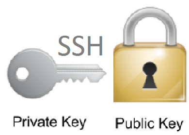
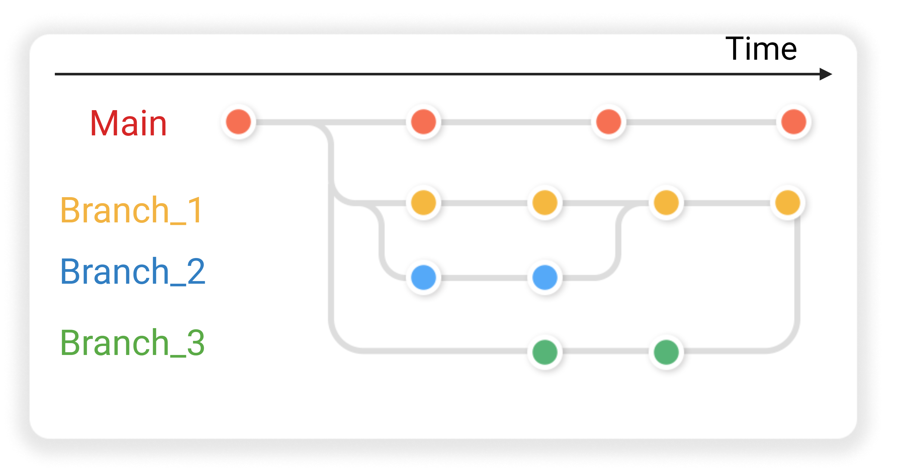
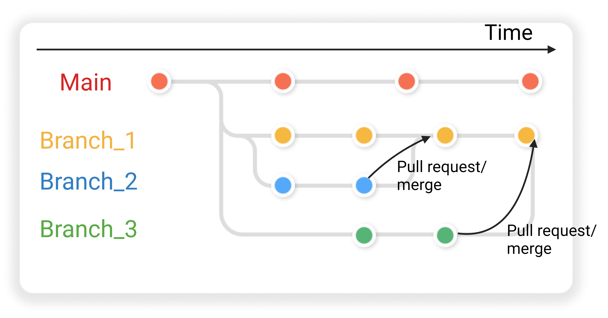

# What are Git remotes? 

## Git remotes

::: {.incremental}

- Git was created to support collaboration among developers working on the Linux kernel.

- Git is distributed: every developer has a local repository containing the full project history.

- Git remotes allow these independent repositories to exchange changes, making collaboration possible without relying on a single central server.

- Remote repositories (Git remotes) are versions of your project that are hosted on the Internet or somewhere on a network (private server, like a institutional server). 

- Collaborating with others involves managing these remote repositories and **pushing** and **pulling** data to and from them when you need to share work.

- **Examples:** GitHub, GitLab, Bitbucket.

:::

## GitHub

- GitHub is a web-based platform for hosting Git repositories, sharing code, and collaborating on projects.

- Launched in 2008, three years after Git was created, it was acquired by Microsoft in 2018.

- It extends Git with collaboration features such as Issues, Pull Requests, code reviews, and discussions.

- It also offers GitHub Actions to automate workflows such as testing and deploying software. 

## Local and remote repositories

<!-- Source slide 4 -->

::: {.box}
**Remote repository**
:::

::: {.columns}
::: {.column width="33%"}
{width="65%"}

Fetch / Pull ←  From Remote

Push → To Remote
:::

::: {.column width="33%"}
{width="65%"}

Fetch / Pull ←  From Remote

Push → To Remote
:::

::: {.column width="33%"}
{width="65%"}

Fetch / Pull ←  From Remote

Push → To Remote

:::
:::

- **Push sends local commits** to the remote; 
- **Fetch/Pull retrieves remote commits** from a remote.

## What we will do today?

| Time | Activity |
|:--|:--|
| 09:30–12:30 | Create a remote repository and clone/push/pull from an existing repository |
| 12:30–13:30 | **Lunch** |
| 13:30–14:30 | Pair assignment of collaboration |
| 14:30–14:45 | **Break** |
| 14:45- 15:30 | Introduction to 4TU.ResearchData |
|15:30-16:00| Feedback (post workshop survey) |

## Let’s start the lesson

<!-- Source slide 6 -->

{width="62%"}

## SSH connection

<!-- Source slide 7 -->

::: {.columns}
::: {.column width="48%"}
{width="85%"}
:::

::: {.column width="52%"}
**Secure Shell (SSH)** is a cryptographic network protocol for operating network services securely over an unsecured network, by providing a secure channel between an SSH client and an SSH server.

::: {.note-box}
SSH keys can be used to authenticate a user when interacting with a Git remote.
:::
:::
:::

## Branches over time

<!-- Source slide 9 -->

{width="89%"}

## Pull requests and merging

<!-- Source slide 10 -->

{width="89%"}

